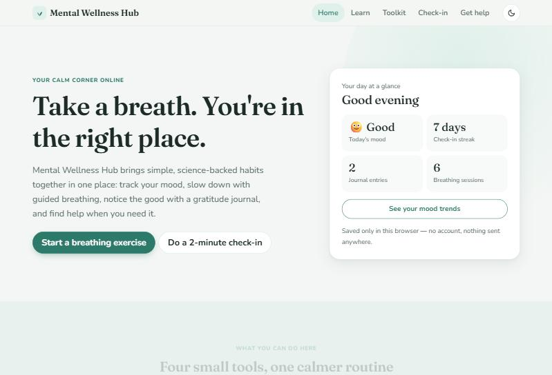
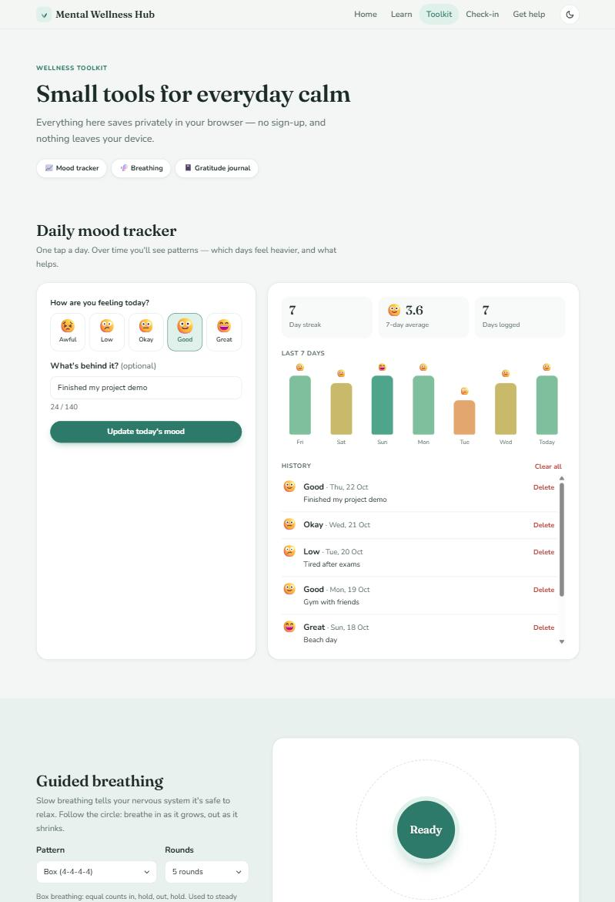
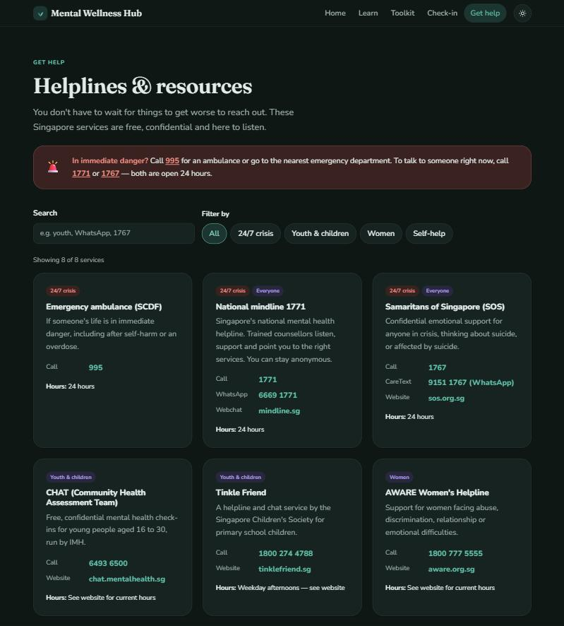
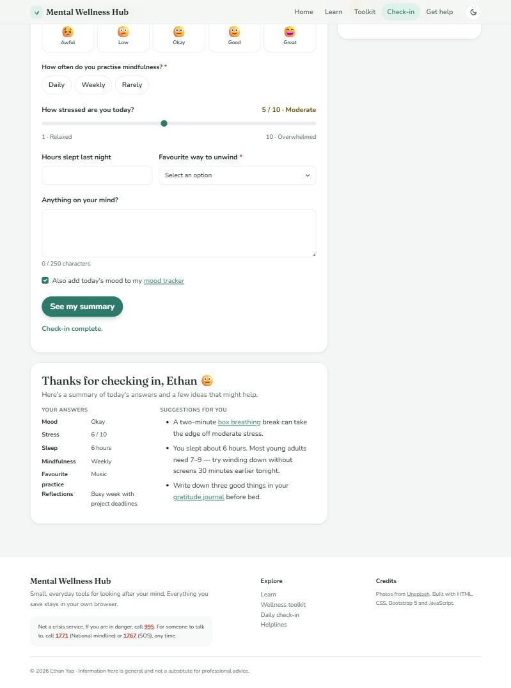
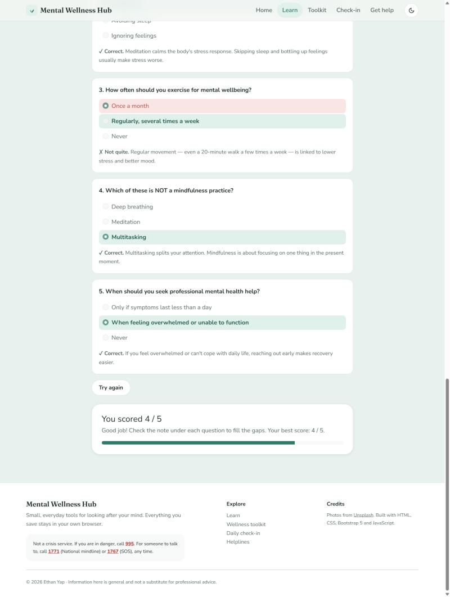
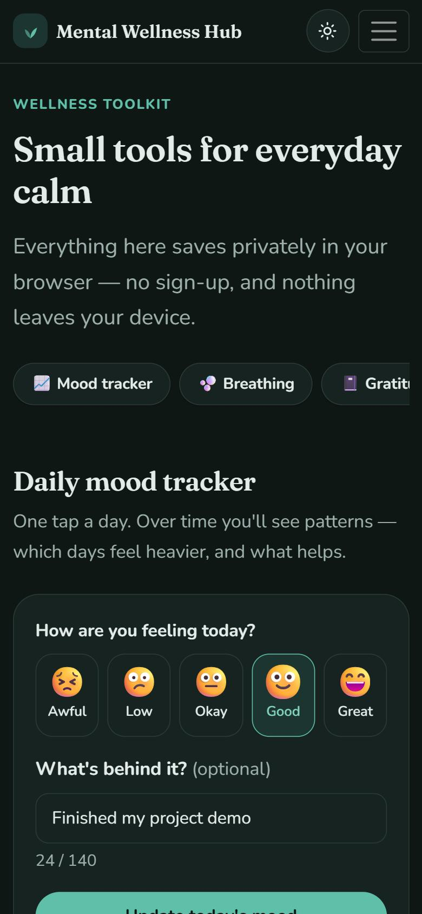

# Mental Wellness Hub

A responsive mental wellness web app with a daily mood tracker, animated breathing exercises, a gratitude journal and a searchable directory of Singapore helplines. Everything runs in the browser and saves privately with `localStorage`, so there is no sign-up and no data leaves the device.

I first built it in Year 1 Semester 1 at Singapore Polytechnic for the Front-End Development (FED) module. In Year 2 I rebuilt it with a new design system, dark mode, accessibility fixes and four new interactive tools.

**Live demo:** [ethanyap123.github.io/mental-wellness-hub](https://ethanyap123.github.io/mental-wellness-hub/)



## Features

| Page | What it does |
| --- | --- |
| **Home** (`index.html`) | Hero section, a "your day at a glance" card that reads your saved mood streak, journal and breathing stats, a feature overview, a tips carousel and featured resources. |
| **Learn** (`info.html`) | What mental health is and why it matters, an FAQ accordion (conditions, stress tips, when to seek help), trends in mental health care, and a 5-question quiz with a progress bar, per-question explanations and a saved best score. |
| **Toolkit** (`tools.html`) | **Mood tracker:** one entry per day with an optional note, a 7-day bar chart, streak, 7-day average and editable history.<br>**Breathing exercise:** an animated circle that guides box (4-4-4-4), 4-7-8 or calm (4-6) breathing for 3, 5 or 10 rounds, with pause/resume and a session counter.<br>**Gratitude journal:** up to three things per entry, random writing prompts, search, delete and export to `.txt`. |
| **Check-in** (`form.html`) | A validated form for mood, stress, sleep and mindfulness habits. It gives a personalised summary with suggestions, can add the mood to the tracker, and keeps a short history (names and comments are never stored). |
| **Get help** (`helplines.html`) | An emergency banner plus a directory of Singapore helplines (National mindline 1771, SOS, CHAT, Tinkle Friend, AWARE and more) with tap-to-call links, category filters and live search. It ends with tips for supporting a friend. |

### Across the site

- **Light and dark mode.** It follows your system setting, has a toggle in the header, remembers your choice and doesn't flash the wrong theme on load.
- **Responsive.** Built mobile-first with Bootstrap's grid, CSS Grid and Flexbox, and tested at 375px, 768px and desktop widths with no horizontal scrolling.
- **Accessible.** Semantic landmarks (`header`, `nav`, `main`, `section`, `footer`), a skip link, labelled form controls and fieldsets, `aria-live` status messages, visible focus styles, keyboard-friendly custom radio "chips", and `prefers-reduced-motion` support. Under reduced motion the breathing circle changes colour instead of size.
- **Safe rendering.** Anything a user types is escaped before it is shown on the page.
- **Gentle motion.** Soft shadows, hover lifts and fade-in sections as you scroll.

## Tech stack

- **HTML5** with semantic markup and ARIA where native HTML isn't enough
- **CSS3** with custom properties (design tokens), Grid, Flexbox, `color-mix()` and media queries
- **Bootstrap 5.3** for the grid, navbar, carousel, accordion and its built-in `data-bs-theme` colour modes
- **Vanilla JavaScript (ES6+)** for DOM rendering, form validation, `localStorage`, `IntersectionObserver` and the Blob download API
- **Google Fonts:** Fraunces (headings) and Nunito (body)

There is no build step and nothing to install.

## Getting started

1. Clone the repository:

   ```bash
   git clone https://github.com/EthanYap123/mental-wellness-hub.git
   cd mental-wellness-hub
   ```

2. Serve the folder with any static server, for example:

   ```bash
   python -m http.server 8000
   ```

3. Open <http://localhost:8000> in your browser.

You can also just open `index.html` directly. All the scripts are plain (non-module) files, so they work over `file://` too.

## Project structure

```
mental-wellness-hub/
├── index.html            Home
├── info.html             Learn + quiz
├── tools.html            Mood tracker, breathing, gratitude journal
├── form.html             Daily check-in
├── helplines.html        Helplines & resources directory
├── assets/
│   ├── css/
│   │   └── style.css     Design tokens, light/dark themes, components
│   ├── img/
│   │   └── favicon.svg
│   └── js/
│       ├── theme.js      Applies the saved theme before first paint
│       ├── main.js       Shared helpers (storage, dates, escaping) + theme toggle
│       ├── home.js       "Your day at a glance" card
│       ├── quiz.js
│       ├── checkin.js
│       ├── mood-tracker.js
│       ├── breathing.js
│       ├── journal.js
│       └── helplines.js  Helpline data + search/filter
└── docs/
    └── screenshots/      Images used in this README
```

## Data and privacy

All data is stored in the browser under these `localStorage` keys:

| Key | Contents |
| --- | --- |
| `mwh-theme` | `"light"` or `"dark"` |
| `mwh-moods` | Mood entries: date, 1–5 score and an optional note |
| `mwh-journal` | Gratitude journal entries |
| `mwh-breath-sessions` | Number of completed breathing sessions |
| `mwh-checkins` | The last 10 check-ins (date, mood, stress, sleep) |
| `mwh-quiz-best` | Best quiz score |

Clearing your browser's site data removes everything.

## Screenshots


| Home | Toolkit | Helplines (dark mode) |
| --- | --- | --- |
|  |  |  |

| Check-in summary | Quiz results | Mobile |
| --- | --- | --- |
|  |  |  |

## Disclaimer

This is a student project for learning and general wellbeing. It is **not** a medical or crisis service. If you or someone you know is in danger in Singapore, call **995**. To talk to someone any time, call **1771** (National mindline) or **1767** (Samaritans of Singapore).

Helpline details were last checked against each organisation's website in October 2026.

## Credits

- Photos from [Unsplash](https://unsplash.com)
- Built with [Bootstrap](https://getbootstrap.com) and [Google Fonts](https://fonts.google.com)

## Author

**Ethan Yap**, Diploma in Information Technology, Singapore Polytechnic
GitHub: [@EthanYap123](https://github.com/EthanYap123)

## License

[MIT](LICENSE)
